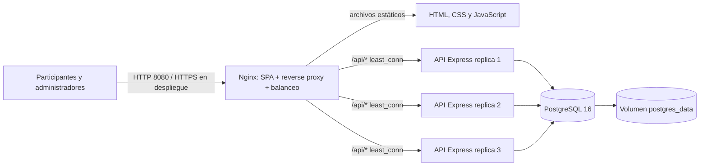

# Arquitectura de Cancha 26

## Vista general



## Componentes

- **Nginx** sirve la SPA y recibe todas las solicitudes del navegador. Las rutas `/api/*` se envían al upstream `backend_pool` con estrategia `least_conn`.
- **API Express** se ejecuta en tres réplicas sin estado local. JWT permite que cualquier réplica atienda una solicitud autenticada.
- **PostgreSQL** conserva usuarios, partidos, predicciones y membresías. La base está fuera de los contenedores de API y persiste en `postgres_data`.
- **Motor de puntuación** calcula los aciertos base, anticipación y rachas cronológicas; los resultados se recalculan dentro de una transacción.
- **k6** crea 100 usuarios únicos, obtiene partidos y envía un pronóstico por usuario a través del mismo Nginx.

## Recorrido de solicitud

1. El navegador descarga la SPA desde Nginx.
2. El cliente llama a rutas relativas `/api/...` en el mismo origen.
3. Nginx selecciona una réplica disponible del backend.
4. Express valida el token y los datos, y consulta PostgreSQL.
5. El volumen de PostgreSQL mantiene la información si se recrean los contenedores.

## Arranque local o en Cloud Shell

```bash
docker compose up --build
```

La aplicación queda en `http://localhost:8080`; la API se accede por el proxy en `http://localhost:8080/api`. La API y PostgreSQL no publican puertos al host. Para escalar manualmente:

```bash
docker compose up --build --scale backend=5
```

El archivo Compose crea tres réplicas por defecto. No se asigna `container_name` al backend para permitir su escalado. El DNS dinámico de Docker en `nginx_balancer.conf` actualiza las direcciones de las réplicas.

## Persistencia y seguridad

- `postgres_data` es un volumen Docker local; `docker compose down` lo conserva. `docker compose down -v` lo elimina.
- El secreto JWT se puede inyectar con `JWT_SECRET`. Si no se define, se genera una clave aleatoria y se guarda en PostgreSQL para compartirla entre réplicas.
- Los valores de base de datos y administrador del Compose son solo valores de conveniencia local. Antes de desplegar, configurar contraseñas propias en `.env`; nunca reutilizar los valores del ejemplo.
- El usuario administrador inicial se toma de `ADMIN_USERNAME` y `ADMIN_PASSWORD`.

## Límite del despliegue

Docker Compose en Cloud Shell o en una VM representa una instalación de un solo host. Aunque la API tenga varias réplicas, PostgreSQL y Nginx siguen siendo puntos únicos de fallo, y el volumen no es almacenamiento multi-zona. Para alta disponibilidad en Google Cloud, desplegar la API como Cloud Run o GKE, usar Cloud SQL for PostgreSQL, guardar secretos en Secret Manager y publicar la entrada mediante un HTTPS Load Balancer. Cloud Shell es un entorno de desarrollo y administración, no un host de producción permanente.
